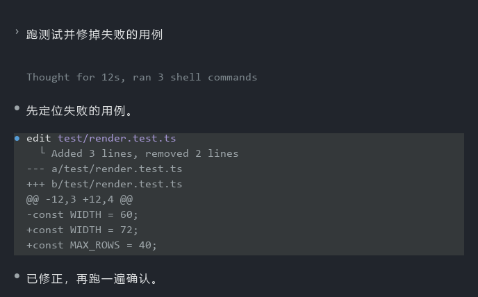
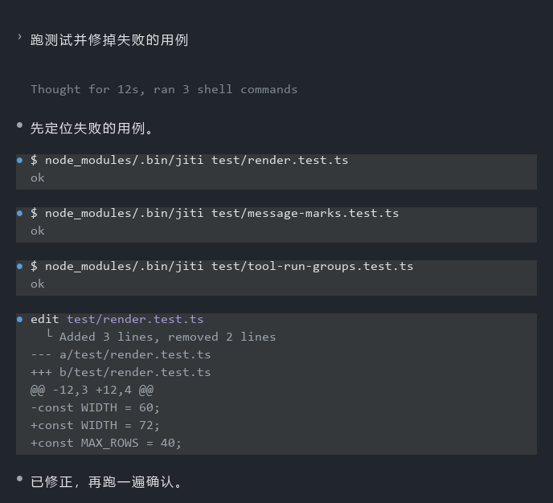

# pi-toolkit

Terminal UI extensions for the Pi coding agent. They change rendering only: tool calls in a request collapse into one summary line, user, assistant, and tool content share a 2-column marker gutter, and `edit` / `write` show their changes by default. Models, tools, and session data stay untouched.

The goal is to read a turn in fewer lines, then expand when you need detail.

All three extensions replace parts of Pi's rendering layer. `tool-run-groups` takes over private methods of `InteractiveMode`, and everything is verified against Pi 1.5.2. A Pi upgrade may degrade or break them; see [Compatibility](#compatibility).

[中文](README.md) | English

## What it looks like



This screen uses all three extensions: `message-marks` draws the gutter, `tool-run-groups` writes the summary line, and `minimal-tools` renders the tool rows and diff.

<details>
<summary>Expanded timeline</summary>



</details>

## Extensions

| Extension | What it does |
|---|---|
| [minimal-tools](extensions/minimal-tools/README.md) | Two-stage tool calls: visible while running, one line when done; `edit` / `write` show changes by default |
| [message-marks](extensions/message-marks/README.md) | 2-column gutter: `›` for user messages and the input, `●` for assistant text and tool calls |
| [tool-run-groups](extensions/tool-run-groups/README.md) | Collapses a request's tool calls into one summary line with thinking time; click or `Ctrl+O` to expand |

Each extension works on its own. Behavior, keybindings, implementation notes, and limits live in the per-directory READMEs.

## Getting started

### Install

```bash
pi install git:github.com/DuskWander87/pi-toolkit
```

One command installs all three extensions. Check with `pi list`, then run `/reload` inside Pi or restart the session.

To install a local clone instead:

```bash
git clone https://github.com/DuskWander87/pi-toolkit
pi install ./pi-toolkit
```

Run the second command from the directory that contains the clone; an absolute path works too.

### Keep only some extensions

```bash
pi config
```

Disable the extensions you do not want. The change applies on the next start.

### Try without saving config

```bash
pi -e ./pi-toolkit
```

`-e` applies to one launch and is cached under `~/.pi/agent/tmp/extensions/`.

### Update and uninstall

```bash
pi update --extensions
pi remove git:github.com/DuskWander87/pi-toolkit
```

## Compatibility

- Verified against Pi 1.5.2; other versions are not promised
- All three extensions depend on Pi internals: `minimal-tools` uses the tool renderer API, `message-marks` wraps exported component prototypes, and `tool-run-groups` takes over private `InteractiveMode` methods. A Pi upgrade may degrade or break them
- Thinking text is shown by default. The hidden label only appears when `hideThinkingBlock` is `true`; the extensions never change that setting
- Click to expand in `tool-run-groups` needs a terminal that reports mouse events. `Ctrl+O` always works

## Tests

```bash
npm test
```

Tests need `jiti` and the two host packages. On a fresh clone without `node_modules`, install them without touching `package.json`:

```bash
npm install --no-save --no-package-lock @earendil-works/pi-coding-agent@1.5.2 @earendil-works/pi-tui@1.5.2 jiti chalk
```

Skip this step when `node_modules` already points at your Pi installation.

| Test | Covers |
|---|---|
| `test/render.test.ts` | `minimal-tools`: tool rows, summaries, expansion, diff, unmatched tools, thinking label |
| `test/message-marks.test.ts` | `message-marks`: user messages, assistant and tool markers, colors, line width |
| `test/editor-prefix.test.ts` | `message-marks`: input prefix, width, cursor |
| `test/tool-run-groups.test.ts` | `tool-run-groups`: grouping, boundaries, summary text, expansion, clicks |

## License

[MIT](LICENSE)
