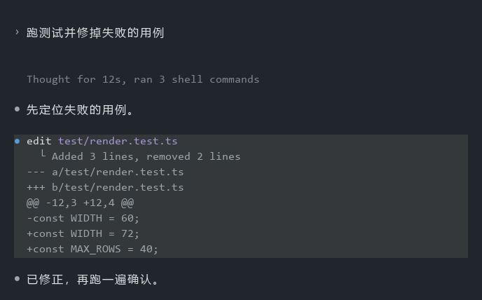
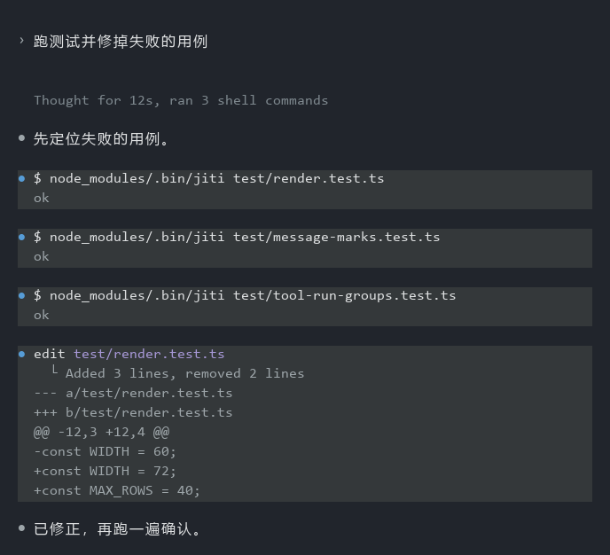

# pi-toolkit

Pi coding agent 的终端界面扩展集合。它只重写对话的渲染：把一次请求里的工具调用收成一行摘要，把用户、助手与工具放进统一的 2 列标记栏，并让 `edit` / `write` 的改动默认可见。模型、工具与会话数据都不改。

目标是用更少的行数读完一轮对话，需要细节时再展开。

三个扩展都替换 Pi 的渲染层，其中 `tool-run-groups` 接管 `InteractiveMode` 的私有方法，已在 Pi 1.5.2 验证。Pi 升级后可能退化或失效，见[兼容性](#兼容性)。

中文 | [English](README.en.md)

## 效果



上面这一屏同时用到三个扩展：`message-marks` 提供标记栏，`tool-run-groups` 提供摘要行，`minimal-tools` 提供工具行与 diff 内容。

<details>
<summary>展开后的时间线</summary>



</details>

## 扩展

| 扩展 | 作用 |
|---|---|
| [minimal-tools](extensions/minimal-tools/README.md) | 工具调用两阶段显示：执行中可见，结束后收成一行；`edit` / `write` 默认展示改动 |
| [message-marks](extensions/message-marks/README.md) | 2 列标记栏：用户消息与输入框 `›`，助手与工具 `●` |
| [tool-run-groups](extensions/tool-run-groups/README.md) | 同一请求的工具调用折叠成一行摘要，含思考耗时；可点击或 `Ctrl+O` 展开 |

三个扩展彼此独立，可以只装其中一个。具体行为、快捷键、实现方式与限制见各目录下的 README。

## 快速开始

### 安装

```bash
pi install git:github.com/DuskWander87/pi-toolkit
```

一条命令装好三个扩展，`pi list` 确认，然后在 Pi 中执行 `/reload` 或重启会话。

已经 clone 到本地时，装本地副本：

```bash
git clone https://github.com/DuskWander87/pi-toolkit
pi install ./pi-toolkit
```

第二条命令在 clone 的上级目录执行，路径也可以写成绝对路径。

### 只保留部分扩展

```bash
pi config
```

在列表里关掉不需要的扩展，下次启动生效。

### 试用后不留配置

```bash
pi -e ./pi-toolkit
```

`-e` 只对这一次启动生效，Pi 会把它缓存在 `~/.pi/agent/tmp/extensions/` 下。同样在 clone 的上级目录执行。

### 更新与卸载

```bash
pi update --extensions
pi remove git:github.com/DuskWander87/pi-toolkit
```

## 兼容性

- 已在 Pi 1.5.2 验证，不承诺其他版本
- 三个扩展都依赖 Pi 的内部结构：`minimal-tools` 使用工具渲染 API，`message-marks` 包装导出的组件原型，`tool-run-groups` 接管 `InteractiveMode` 的私有方法。Pi 升级后可能退化或失效
- 摘要收起时思考正文不占行；展开后显示思考正文。Pi 的 `hideThinkingBlock` 为 `true` 时，摘要区间内的轮次整段不显示思考，也没有可点开的标签，耗时只出现在摘要行上。想读思考正文需要关掉该设置，扩展不修改它
- `tool-run-groups` 的点击展开依赖终端支持鼠标事件；`Ctrl+O` 始终可用

## 测试

```bash
npm test
npm run typecheck
```

`npm run typecheck` 用 npx 临时运行 TypeScript，首次需要联网，不写入 `node_modules`。

测试依赖 `jiti`、`chalk` 与两个 host 包，类型检查另需 `@types/node`（它在 host 包的开发依赖里，不会随上面这些包一起装上）。新 clone 且没有 `node_modules` 时，先装一份不写入 `package.json` 的依赖：

```bash
npm install --no-save --no-package-lock @earendil-works/pi-coding-agent@1.5.2 @earendil-works/pi-tui@1.5.2 jiti chalk @types/node
```

本机已经把 `node_modules` 指向 Pi 安装目录时，跳过这一步。

| 测试 | 覆盖 |
|---|---|
| `test/render.test.ts` | `minimal-tools`：工具行、摘要、展开、diff、表外工具、思考标签 |
| `test/message-marks.test.ts` | `message-marks`：用户消息、助手与工具圆点、颜色、行宽 |
| `test/editor-prefix.test.ts` | `message-marks`：输入框前缀、宽度与光标 |
| `test/tool-run-groups.test.ts` | `tool-run-groups`：聚合、边界、摘要文案、展开与点击 |
| `test/integration.test.ts` | 三个扩展同时安装时的左缘对齐与静默轮次可见性 |

## 许可

[MIT](LICENSE)
