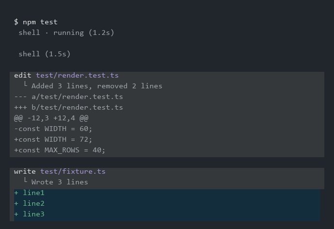

# minimal-tools

工具调用的两阶段显示：执行中保留调用信息，成功结束后收成一行摘要；`edit` / `write` 默认展示改动内容。

## 效果



```text
执行中
  shell · running (1.2s)

成功后收起
  shell (1.5s)

失败时保留命令行与完整错误输出
  $ npm test
  ...完整错误输出（红色）
```

行首缩进做了简化，实际由 Pi 的 `outputPad` 与 `message-marks` 决定。`Ctrl+O` 展开后，命令行与完整输出放在同一块 `toolPendingBg` 背景区域内。

## 行为

| 工具 | 执行中 | 收起（成功） |
|---|---|---|
| `bash` | 命令行 + `shell · running (1.2s)` | `shell (1.5s)` |
| `read` | 调用行 | `read 120 lines` |
| `grep` | 调用行 | `grep 3 matches` |
| `find` | 调用行 | `found 2 files` |
| `ls` | 调用行 | `ls . · 4 entries` |
| `edit` | 调用行 | 标题 + 增删统计 + diff（默认最多 30 行） |
| `write` | 调用行 | 标题 + 写入行数 + 预览（默认最多 10 行） |
| 其他工具 | 调用行 | `<工具名> · N lines` |

文本类工具的摘要末尾会附执行耗时（如 `read 120 lines (0.3s)`），不足 1 秒时显示毫秒。

### 执行中

调用行始终可见。只有 `bash` 会持续发送部分结果，因此额外显示 `· running (已用时间)` 并每秒刷新；其他内置工具不发送部分结果，执行期间只有调用行。

### 失败

错误不会被折叠：保留调用行，并显示完整错误输出。

### 展开

`Ctrl+O` 切换 Pi 的全局工具展开状态：

- `bash`：`$ command` + 完整输出
- `read`：`read <path>[:range]` + 完整输出
- `grep`：`grep /pattern/` + 完整输出
- `find`：`find <pattern>` + 完整输出
- `ls`：`ls <path>` + 完整输出
- 其他工具：`<工具名> <参数摘要>` + 完整输出

### `edit`

- 标题行：`edit <path>`，路径中的 home 目录缩写为 `~`
- 统计行：`└ Added 2 lines, removed 1 line`；无改动时显示 `└ No changes`
- diff 默认最多 30 行，超出显示 `... (N more lines, ctrl+o to expand)`
- 行级底色区分增删，整行铺满渲染宽度；单行删除 + 单行新增时，再叠加词级高亮标出真正变化的字符

### `write`

- 标题行：`write <path>`
- 统计行：`└ Wrote 12 lines`
- 预览默认最多 10 行，每行以 `+ ` 起头；超出显示截断提示

### 表外工具

未单独适配的工具会自动套用同一套两阶段渲染：

- 调用行取第一个非空字符串参数，截断到 40 字符
- 结果收起为 `<工具名> · N lines`
- 结果包含非文本内容（如图片）时交回 Pi 内置渲染，避免折叠丢内容

### 思考标签

`session_start` 时把隐藏思考的标签设为正体 `Thinking...`，颜色取主题的 `thinkingText`。该标签只在 `settings.json` 的 `hideThinkingBlock` 为 `true` 时可见；Pi 默认 `false`，显示思考正文。

## 安装

安装、更新与卸载见[根 README](../../README.md#快速开始)。

## 交互与配置

- `Ctrl+O`：在收起 / 展开之间切换
- 没有扩展自己的配置项
- 是否显示思考正文仍由 Pi 的 `hideThinkingBlock` 决定，扩展只负责标签样式

## 与其他扩展

- 单独安装即可工作
- 与 `message-marks` 一起装时，工具行会被对齐到 2 列标记栏，首行带状态圆点
- 与 `tool-run-groups` 一起装时，本扩展渲染出的工具行会被折叠进摘要；展开后仍是同样的内容

## 实现原理

- 通过 `pi.registerToolRenderer` 提供 `renderCall` / `renderResult`，并用 `renderShell: "self"` 接管 7 个内置工具的渲染槽
- 只替换渲染，不替换执行：`bash` 的 `shellPath`、`PI_*` 环境变量等仍由 Pi 内置定义处理
- 运行中计时保存在 `context.state`，每秒调用一次 `invalidate()`，结束时清除 interval
- diff 配色按 `theme.appearance` 在深色 / 浅色两套 RGB 底色中切换

## 限制

- **实时耗时只覆盖 `bash`**：其余内置工具不发送部分结果，执行期间没有每秒刷新
- **diff 与预览默认截断**：`edit` 30 行、`write` 10 行，完整内容需要 `Ctrl+O`
- **词级高亮有前提**：只处理「单行删除 + 单行新增」的配对；变化字符超过行内容 70% 时退化为行级底色，单行超过 300 字符时改用公共前后缀定位
- **主题切换**：思考标签颜色在 `session_start` 时取值，切换主题后需要 `/reload`；diff 底色只看明暗外观，自定义主题的配色可能与扩展不一致
- **依赖 Pi 的渲染 API**：`registerToolRenderer`、`ToolRenderers`、`context.state`、`context.outputPad` 等结构变化时需要同步调整

## 测试

`test/render.test.ts` 覆盖调用行、running 计时、成功摘要、错误块、展开、edit / write 截断、表外工具、图片回退、缺失参数与隐藏思考标签。运行方式见[根 README](../../README.md#测试)。

---

返回 [pi-toolkit 根 README](../../README.md)。
