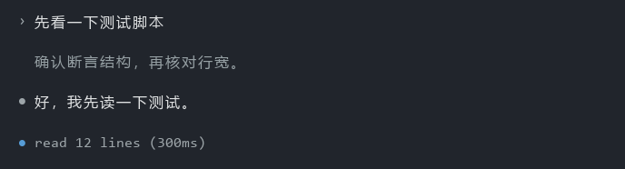

# message-marks

2 列标记栏：标记占第 1 列，内容统一缩进 2 列。只包装 Pi 导出的组件原型，不改任何消息数据。

## 预览



```text
❯ 先看一下测试脚本
  续行与首行内容对齐

  思考正文从第 2 列开始
● 好，我先读一下测试。
  续行、思考行与工具块都在第 2 列
● bash npm test
  ...工具正文同样从第 2 列开始
```

输入框首行也以 `❯ ` 起头，多行输入在等宽留白后对齐。

## 特性

### 标记规则

| 位置 | 标记 | 颜色 |
|---|---|---|
| 用户消息首个内容行 | `❯ ` | `getSelectListTheme().description` |
| 输入框首个内容行 | `❯ ` | 同上 |
| 助手消息首个文本块首行 | `●` | 同上 |
| 工具调用首行：进行中 / 成功 | `●` | 固定蓝 `rgb(86,156,214)` |
| 工具调用首行：失败 | `●` | 主题 `error`（红） |
| 技能调用首行 | `●` | 固定蓝 `rgb(86,156,214)` |
| `!` 命令、压缩/分支摘要、自定义消息 | 无（只缩进） | 不加标记 |

### 对齐

- 标记栏固定 2 列：第 1 列放标记，第 2 列为空格
- 助手消息与工具块的每一行都补到第 2 列；首行用标记替换原有的两格留白
- 用户消息只在首个内容行插入前缀，后续行补等量空格，使内容从同一列开始
- 系统类组件每行补到第 2 列，不加标记
- 接管块整体按扣除标记栏后的宽度排版一次：正文不会因为插入标记栏被截掉
- 渲染器忽略宽度参数、依旧返回超宽行时截回渲染宽度，否则 Pi 会因超宽行抛错
- 块与块之间统一留 1 行空行：每个块去掉尾随空行，跟在 Pi `Spacer(1)` 后面的块（用户消息、技能调用、压缩/分支摘要）不再保留自身首行空行；块首或块尾挨着终端图片时，那一侧保持原样（图片行与它的占位空行是图片自身的高度）
- 代码块、列表等已有缩进保持相对结构；终端图片行（Kitty / iTerm2 协议）不参与缩进与标记

### 用户消息

去掉原来的背景色；代码块首行同样带前缀，围栏与正文的相对缩进不变。

### 助手消息

- 思考块与错误提示不算文本块，圆点不会落在 `Thinking...` 上
- 没有文本块的助手消息（例如只有思考）不加圆点

### 工具调用

工具结果的正文、diff 与截断提示都在标记栏右侧。

### 系统类消息

技能调用去掉 Box 的背景色，与工具行共用同一套标记栏。`!` 命令、compaction / branch summary、custom message 保留原有的背景色。

### 输入框

- `❯ ` 前缀占用左侧内边距，不叠加在文本上
- 换行宽度、光标位置与鼠标定位都按加宽后的内边距计算
- 窄终端下内边距不足以容纳前缀时保持原样
- 保留 Pi 默认输入框的工作状态嵌入上边框

## 安装

```bash
git clone https://github.com/DuskWander87/pi-toolkit
pi install ./pi-toolkit/extensions/render/message-marks   # 安装
pi -e ./pi-toolkit/extensions/render/message-marks        # 只试用一次，不写入配置
pi remove ./pi-toolkit/extensions/render/message-marks    # 卸载
```

在 clone 的上级目录执行，已经有仓库时跳过 `git clone`。更新时在 clone 目录执行 `git pull`，然后在 Pi 中 `/reload`。装齐全部扩展见[根 README](../../../README.md#快速开始)。

## 用法

- 没有快捷键、命令或配置项，安装后直接生效
- 输入框的按键、自动补全与鼠标行为沿用 Pi 默认实现

## 与其他扩展

- 单独安装即可工作
- 与 `tool-run-groups` 共用 2 列标记栏宽度：摘要行由 `tool-run-groups` 自己缩进到第 2 列，本扩展不为它加圆点
- 与 `minimal-tools` 一起装时，本扩展负责工具行的缩进与圆点，`minimal-tools` 负责行内内容；此时 Pi 的 `outputPad` 不再影响工具行左缘（固定在第 2 列），只决定行内可用换行宽度

## 限制

### 依赖

- 组件内部结构：助手圆点的位置读取 `contentContainer.childLines` 与 `markdownSlots`；Pi 更新若改变这些字段，圆点会退化或错位
- 输入框通过 `ctx.ui.setEditorComponent` 接管；如果另一个扩展之后也调用 `setEditorComponent`，后注册的编辑器会覆盖本扩展，两者共存时需要包一层工厂

### 已知问题

- **成功蓝是固定 RGB**：主题没有蓝色令牌，无法随自定义主题变化
- **只标第一个文本块**：一条助手消息中的后续文本块不加圆点
- **图片行不缩进**：终端图片自带单元格定位，保持原样
- **忽略宽度参数的渲染器会被截断**：系统类组件或 `customRenderer` 直接返回固定宽度的行时，右侧按渲染宽度截回
- **接管块正文窄 2 列**：标记栏占的是渲染宽度里的 2 列，Markdown 正文（自定义消息、压缩/分支摘要、技能内容）因此比助手消息早 2 列换行；`outputPad=0` 的工具行同理。助手消息与用户消息不经过这一级，宽度不受影响
- **Pi 直接插入的提示行紧贴上一块**：扩展报错这类不是消息组件的行由 Pi 直接追加，本扩展不参与，与上一块之间没有空行
- **代码块相对缩进少 1 列**：正文移到第 2 列后，块内相对缩进比原来少 1 列

### 非目标

- 固定 2 列：没有可配置的标记栏宽度

## 实现原理

包装导出的组件原型，Pi 没有普通消息的渲染钩子（`registerMessageRenderer` 只处理 `custom` 消息）：

- `UserMessageComponent.render`：去背景色 + 首行前缀
- `AssistantMessageComponent.render`：整条消息对齐 + 首个文本块圆点
- `ToolExecutionComponent.render`：整块对齐 + 状态圆点
- `SkillInvocationMessageComponent.render`：去背景色 + 整块对齐 + 圆点
- `BashExecutionComponent`、`CompactionSummaryMessageComponent`、`BranchSummaryMessageComponent`、`CustomMessageComponent`：统一补缩进；压缩/分支摘要位于 `Spacer(1)` 之后，不再保留首行空行
- 补缩进需要 2 列：整块直接按 `width - 2` 渲染一次，缩进只在左侧补位把 2 列补回、行尾补齐到渲染宽度；不探测、不重渲染，每次刷新只有一遍排版，上游按宽度缓存排版结果
- 宽度小到放不下标记栏（`width - 2 < 1`）时保持原宽度，交给调用方截断
- 每个块渲染后由 `normalizeBlockSpacing` 收敛首尾空行，被删掉空行上的 OSC 133 分区标记挂回相邻行
- 输入框由 `CustomEditor` 子类 `PromptPrefixEditor` 实现：`getPaddingX()` 返回原值，`setPaddingX()` 自动加上 2，对外仍是调用方设置的宽度

安装时把原始 `render` 保存在 `Symbol.for` 键上，重复安装（含同进程 `/reload`）用新 wrapper 覆盖旧的，不会叠加；从没有保存原始方法的旧版本第一次升级后需要重启一次 Pi，之后 `/reload` 即可。渲染结果按组件缓存，内容未变时省去逐行正则与宽度计算。主题代理在 `session_start` 取得，切换主题后工具圆点颜色仍跟随。

## 测试

`test/render/message-marks.test.ts` 覆盖用户消息前缀、助手与工具圆点、颜色、行宽、满宽正文不丢字、单遍渲染、系统类组件缩进、块间距与重复安装。输入框单独覆盖前缀、宽度、对齐与工作状态。运行方式见[根 README](../../../README.md#测试)。

---

返回 [pi-toolkit 根 README](../../../README.md)。
