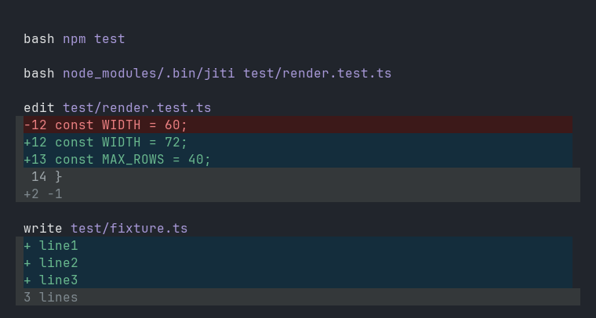

# minimal-tools

工具调用收成一行：调用行以工具注册名开头，后面接参数，结束后再补上量化字段（`grep /TODO/ · 3 matches`）。只替换渲染，不改工具的执行方式。

## 预览



```text
执行中
  bash npm test

成功后收起：调用行与结果合成一行
  bash npm test

其他工具在同一行补量化
  read src/app.ts:10-29 · 20 lines

  grep /TODO/ · 3 matches

失败时保留调用行，错误输出单独成块
  bash npm test
  ...完整错误输出（红色）
```

图中行首缩进由 Pi 的 `outputPad` 与 `message-marks` 决定。

## 特性

| 工具 | 收起后的一行 |
|---|---|
| `bash` | `bash <命令>` |
| `read` | `read <path>[:range] · N lines`；图片为 `· image` |
| `grep` | `grep /<pattern>/ · N matches` |
| `find` | `find <pattern> · N files` |
| `ls` | `ls <path> · N entries` |
| `edit` | `edit <path>` + diff 块，块尾 `+2 −1`（无改动为 `no changes`） |
| `write` | `write <path>` + 预览块，块尾 `N lines` |
| 其他工具 | `<工具名> <参数摘要> · N lines` |

`bash` 的量化字段就是命令本身。`edit` / `write` 的标题行与改动内容同时可见。

### 执行中

调用行始终可见。`bash` 的部分结果不参与渲染，展开后才看得到完整输出。

### 收起

成功结束后由结果行输出整行：标题后面接 ` · 量化`（`dim` 灰色，与标题的 `toolTitle` / `accent` 区分）。量化字段取工具自己的口径：

- `read`：数据行数（含空行，剔除尾部截断提示）；结果是图片时为 `image`
- `grep` / `find` / `ls`：匹配条数 / 文件数 / 目录项数，剔除 `[500 entries limit reached…]` 这类尾部提示
- `edit` / `write`：量化字段在块尾（`+2 −1`、`N lines`）
- 其他工具：数据行数

### 失败

错误不会被折叠：保留调用行，完整错误输出放进一块背景区域，连续空行压成一个。

### 展开

`Ctrl+O` 展开后，调用行留在外面，完整输出放在一块 `toolPendingBg` 背景区域内，块内只有正文。

- `bash`：`bash <命令>` + 完整输出
- `read`：`read <path>[:range]` + 完整输出
- `grep` / `find` / `ls` / 其他工具：同样的「调用行 + 输出块」

### edit

- 调用行：`edit <path>`，路径中的 home 目录缩写为 `~`
- diff 块尾给增删统计：`+2 −1`；无改动时为 `no changes`
- diff 默认最多 30 行，超出显示 `... (N more lines, ctrl+o to expand)`
- 行级底色区分增删，整行铺满渲染宽度；单行删除 + 单行新增时，再叠加词级高亮标出真正变化的字符
- 超宽行折成多行，续行与首段内容列对齐：西文在空白处断行，中日韩字符逐字断行，一行内没有可断点时硬切

### write

- 调用行：`write <path>`
- 预览默认最多 10 行，每行以 `+ ` 起头；超出显示截断提示；超宽行与 `edit` 一样折行
- 块尾给写入行数

### 其他工具

未单独适配的工具尊重上游渲染：

- 上游提供 `renderCall` 或 `renderResult` 任一槽时整体让位（例如 Pi 内置的 `powershell`）；上游只提供 `renderShell`、没有调用行 / 结果行时，仍由本扩展折叠
- `web_search` / `fetch_content` / `get_search_content` 例外：两个渲染槽都在时保留上游的调用行、进度条与结果分组，只套无底色的行级外壳，缩进由 `outputPad` 补回。收起态的行数与内容仍由上游决定，不带本扩展的量化字段
- 两个槽都没有时套用同一套渲染：调用行取工具名 + 第一个非空字符串参数（截断到 40 字符），收起态末尾接数据行数
- 没有上游渲染槽的工具返回图片时，量化只统计文本行（可能显示 `0 lines`），图片由 Pi 独立渲染

### 思考标签

`session_start` 时把隐藏思考的标签设为正体 `Thinking...`，颜色取主题的 `thinkingText`。该标签只在 `settings.json` 的 `hideThinkingBlock` 为 `true` 时可见；Pi 默认 `false`，显示思考正文。

## 安装

```bash
git clone https://github.com/DuskWander87/pi-toolkit
pi install ./pi-toolkit/extensions/render/minimal-tools   # 安装
pi -e ./pi-toolkit/extensions/render/minimal-tools        # 只试用一次，不写入配置
pi remove ./pi-toolkit/extensions/render/minimal-tools    # 卸载
```

在 clone 的上级目录执行，已经有仓库时跳过 `git clone`。更新时在 clone 目录执行 `git pull`，然后在 Pi 中 `/reload`。装齐全部扩展见[根 README](../../../README.md#快速开始)。

## 用法

- `Ctrl+O`：在收起与展开之间切换
- 没有扩展自己的配置项

## 与其他扩展

- 单独安装即可工作
- 与 `message-marks` 一起装时，工具行对齐到 2 列标记栏，首行带状态圆点；本扩展按 `outputPad` 补的缩进被标记栏吸收，`outputPad` 只剩影响换行宽度
- 与 `tool-run-groups` 一起装时，本扩展渲染出的工具行会被折叠进摘要；展开后仍是同样的内容
- 与 `run-clock` 一起装时，整段请求的耗时与生成量显示在输入框上方，工具行不重复报耗时

## 限制

### 依赖

- Pi 的渲染 API：`registerToolRenderer`、`ToolRenderers`、`context.outputPad`。结构变化时需要同步调整
- 搜索类工具名硬编码在 `UPSTREAM_RENDERER_TOOLS`：`pi-web-access` 改名（含它的 `toolNames` 配置）后换壳静默失效，这些工具行会重新出现整块底色，渲染内容本身不受影响
- 搜索类工具的错误底色由上游决定：`pi-web-access` 的结果渲染只看 `details.error`，不看 `isError`，工具抛异常这类错误会渲染成正常状态行。本扩展不另铺底色：上游多数错误分支自带 `toolErrorBg` 块，再套一层会让一行出现两段底色

### 已知问题

- 截断与折行：`edit` 30 行、`write` 10 行；块内单行最多折 20 行，末行以 `…` 收尾，展开后不限
- 词级高亮只处理「单行删除 + 单行新增」的配对：变化字符超过行内容 70% 时退化为行级底色，单行超过 300 字符时改用公共前后缀定位
- 主题切换：思考标签颜色在 `session_start` 时取值，切换主题后需要 `/reload`；diff 底色只看明暗外观，自定义主题的配色可能与扩展不一致

### 非目标

- 不做配置项：截断行数、颜色、量化口径都写死

## 实现原理

- 通过 `pi.registerToolRenderer` 提供 `renderCall` / `renderResult`：先查定制表，再让位给上游，两者都没有时使用通用折叠
- 排版只有三个原语：`toolHeader`（工具名 + 参数）、`summaryLine`（`调用行 · 量化`）、`renderToolResult`（块 + 调用行）；每个工具只提供自己的参数摘要与量化字段
- 收起成功时 `renderCall` 返回空，`renderResult` 用同一份标题拼出单行
- 历史回放（`pi -c` / `-r`、`/tree`、`/reload`、压缩后重建）时渲染器拿到的 `executionStarted` 与 `argsComplete` 都是 `false`：调用行让位，标题只由结果行给出；实时流程靠 `argsComplete` 区分「参数已齐、尚未开始执行」那一帧
- diff 配色按 `theme.appearance` 在深色 / 浅色两套 RGB 底色中切换

## 测试

`test/render/minimal-tools.test.ts` 覆盖调用行、收起态单行、量化口径、错误块与展开，以及 diff / 预览的截断、折行对齐与极窄宽度。调用行的工具名与参数、图片回退、缺失参数、隐藏思考标签与搜索类工具的换壳各有用例。运行方式见[根 README](../../../README.md#测试)。

---

返回 [pi-toolkit 根 README](../../../README.md)。
