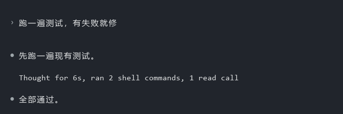
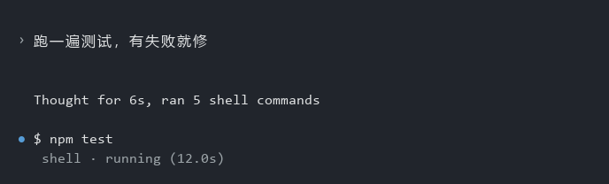
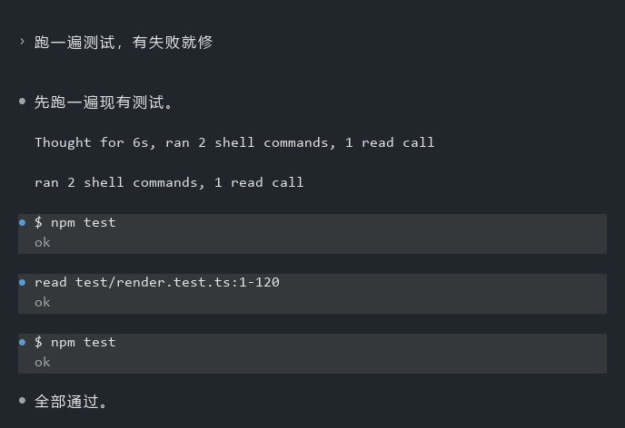

# tool-run-groups

把连续的工具调用折叠成一行摘要，展开后是完整时间线。

## 效果



<details>
<summary>执行中：已完成部分收成摘要，正在跑的工具行留在摘要下方</summary>



</details>

<details>
<summary>展开后的时间线</summary>



</details>

```text
收起
  Thought for 12s, ran 3 shell commands
● edit test/render/minimal-tools.test.ts
  └ Added 2 lines, removed 1 line
  ... (4 more lines, ctrl+o to expand)

单条调用
  Thought for 1s, ran 1 read call
  ... (read 的路径与内容在展开后可见)

执行中（已完成部分收成摘要，正在跑的工具行留在摘要下方）
  Thought for 6s, ran 5 shell commands
● $ npm test
   shell · running (12.0s)

有失败时
  Thought for 12s, ran 3 shell commands · 1 failed
```

摘要行缩进 2 列，与 `message-marks` 的标记栏对齐；摘要行本身不带圆点。`edit` / `write` 始终逐条可见，不靠摘要行代表。

回复正文与摘要行按发生顺序排列：正文先出现，它引发的思考与工具调用收在下面那行摘要里。模型写完一段话再继续干活时，新一行摘要就在那段话下面，不会把新调用算进上面那一行。

## 两级聚合

| 级别 | 范围 | 结果 |
|---|---|---|
| 单轮 | 一条助手消息内连续的至少 2 个且都已执行结束的工具行 | 收成一行 `ran ...` |
| 区间 | 一段连续的工具调用：从工具调用开始，到下一次回复正文或用户消息之前 | 这一区间只留一行摘要，思考正文收进摘要行，思考耗时按轮累加 |

### 会聚合的内容

- 连续的工具调用行
- 「静默轮次」：没有可见文本、只思考和调工具的助手消息
- 已经被第一级聚合的工具行

### 聚合边界

- 回复正文是硬边界：正文先于摘要行渲染，它之后的思考与工具调用另起一行摘要，不并入上面那一行
- 单轮内只有一条工具调用时第一级不聚合，由区间摘要折叠成 `ran 1 read call`
- 执行中的工具行不折叠：区间里已结束的调用（含并行调用中先结束的）先收成摘要行，只有正在跑的工具行留在摘要下方，保留命令行、流式输出与实时计时；工具结束后由 `tool_execution_end` 触发一次重新扫描，并入同一行摘要
- `edit` / `write` 始终逐条渲染；它们可以出现在折叠区间内，但不计入摘要
- 被中断、报错或截断的轮次是硬边界
- 用户消息是硬边界；区间前那条回复留在区间外，作为摘要行的耗时来源

### 摘要文案

| 状态 | 文案 |
|---|---|
| 收起，有思考耗时 | `Thought for 28s, ran 8 shell commands` |
| 收起，无思考耗时 | `ran 8 shell commands` |
| 有失败 | 在末尾追加 ` · 1 failed`，只有这一段标红，摘要正文保持 dim |

执行中的工具行不产生摘要，摘要只统计已结束的调用；它们保持原行与实时计时，工具结束后并入摘要行。并行调用中先结束的调用照常计入摘要，不等还在跑的那条。

工具名按首次出现顺序汇总，`bash` 显示为 `shell`：

- `2 shell commands`
- `1 read call` / `3 read calls`

### 思考耗时

- 从助手消息开始到最后一个思考片段的间隔，四舍五入到秒，最少显示 1 秒
- 摘要行累加区间内所有轮次的耗时，包括区间前那条回复与区间内静默轮次的耗时；收尾回复不在任何区间里，保留自己的 `Thought for Ns` 标签
- 收起时由摘要行代表思考：区间内的静默轮次与区间前那条回复都不显示思考正文，只留正文与摘要行；区间外的回复按 Pi 的设置显示
- 展开后显示思考正文；Pi 的 `hideThinkingBlock` 为 `true` 时，这些轮次连隐藏标签也不显示，耗时只在摘要行上。想读思考正文需要把该设置关掉
- 耗时一旦计入摘要，就不再单独显示来源的 `Thought for Ns` 标签：区间内所有轮次与区间前那条回复的标签无条件清空，收起与展开都不重复；区间里一段工具调用都没有时没有摘要行，标签保留

## 展开与点击

- `Ctrl+O`：切换 Pi 的全局工具展开状态，摘要与内部工具行一起展开
- 点击摘要行：收起 / 展开；两级摘要都只有这一行负责切换
- 收起时 `edit` / `write` 行逐条显示，点击落到行上（展开 diff），不会切换摘要；正文在摘要之外，本来就按自己的一段渲染

## 安装

在 clone 的上级目录执行；已经有仓库时跳过 `git clone`：

```bash
git clone https://github.com/DuskWander87/pi-toolkit
pi install ./pi-toolkit/extensions/render/tool-run-groups
```

只试用一次，不写入配置：

```bash
pi -e ./pi-toolkit/extensions/render/tool-run-groups
```

卸载：

```bash
pi remove ./pi-toolkit/extensions/render/tool-run-groups
```

更新时在 clone 目录执行 `git pull`，然后在 Pi 中 `/reload`。装齐全部扩展见[根 README](../../../README.md#快速开始)。

## 交互与配置

- `Ctrl+O` 或点击摘要行展开
- 没有扩展自己的配置项
- 点击依赖终端支持鼠标事件；不支持时仍可用 `Ctrl+O`

## 与其他扩展

- 单独安装即可工作，Pi 内置工具行与 `minimal-tools` 渲染的工具行都能聚合
- 与 `message-marks` 共用 2 列标记栏：摘要行缩进 2 列，但不由 `message-marks` 加圆点
- 与 `minimal-tools` 一起装时，展开后的每个工具行仍是两阶段渲染的完整内容；执行中的工具行按 `minimal-tools` 的实时行呈现，结束后并入摘要行

## 实现原理

Pi 没有消息级渲染钩子（`registerMessageRenderer` 只处理 `custom` 消息），因此本扩展接管 `InteractiveMode` 的私有方法：

- `handleEvent`：在 `message_end` 之后记录思考耗时、替换隐藏思考标签，并聚合当前工具行；在 `tool_execution_end` 之后重新扫描一次，把刚跑完的工具收进摘要
- `renderSessionItems`：历史回放结束后同样聚合
- `updateThinkingBlockVisibility`：先交给 Pi 处理顶层消息，再把可见性同步到摘要与工具组内部；收起态一律隐去思考正文，展开态跟随 Pi 的设置

聚合只是把 Pi 自己创建并持续更新的 `ToolExecutionComponent` 移入容器组件，工具执行、结果回填与会话数据都不受影响。重复聚合不会叠加；区间未变化时复用原实例，保留用户的折叠状态。如果 `InteractiveMode` 的内部方法缺失，安装失败并在 `session_start` 时提示。

## 限制

- **依赖 `InteractiveMode` 私有成员**：`handleEvent`、`renderSessionItems`、`chatContainer`、`toolOutputExpanded` 都不是公开 API
- **执行期间会多出正在跑的工具行**：正在跑的工具行不进摘要，于是执行中看到的是「一行摘要 + 正在跑的工具行」，工具跑完才收敛成一行摘要。实时计时与「执行期间也只有一行」不可兼得，当前选前者：长命令执行期间，命令行、输出和计时比提前合并更有用
- **静默轮次判定依赖助手组件内部字段**：`markdownSlots` 与 `lastMessage.stopReason`；结构变化时退化到不合并，不会错误地藏起内容
- **历史回放没有逐轮思考耗时**：耗时在 `message_end` 时采集，只存在内存里；任何按 session entry 重建视图的路径（`-r` / `-c`、`/tree` 跳分支、`/reload`、切换 cache miss 提示）都会换了一批新组件，摘要行与隐藏标签不带 `Thought for Ns`，收起态也就看不到那一轮思考过的痕迹。Pi 不持久化思考耗时（`AssistantMessage` 里没有耗时字段）。下面两条是可选改法，均未实施：
  - **无耗时标记**：`thoughtMs` 缺失但该轮有思考内容时，摘要行写成 `Thought, ran 2 shell commands`，不编造秒数，也不改会话数据
  - **持久化耗时**：`message_end` 时用 `appendEntry` 把每轮耗时写进 session（不进 LLM 上下文；未注册 entry renderer 时不渲染），回放时按 `responseId` 配对填回，缺失该字段时回退到相邻顺序；代价是会话文件每轮多一条记录，并多一份跨 Pi 版本的私有数据契约
- **思考可见性同步只覆盖摘要与工具组**：收起时由摘要行管理思考正文（含区间前那条回复），展开时按 Pi 的设置显示；摘要之外的回复与其他容器沿用 Pi 原本的处理

## 测试

`test/render/tool-run-groups.test.ts` 覆盖单轮与区间聚合、静默轮次判定与各类边界（文本回复、报错、中断、用户消息）。摘要文案、失败标红与思考耗时单独覆盖。执行中的聚合覆盖并行调用先结束的情况，摘要按发起顺序汇总。展开状态传递、点击行为与实例复用各有用例。运行方式见[根 README](../../../README.md#测试)。

---

返回 [pi-toolkit 根 README](../../../README.md)。
