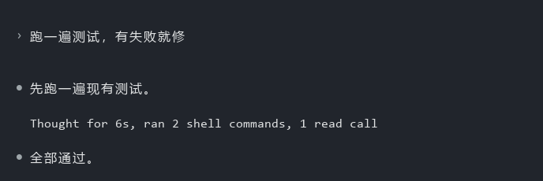
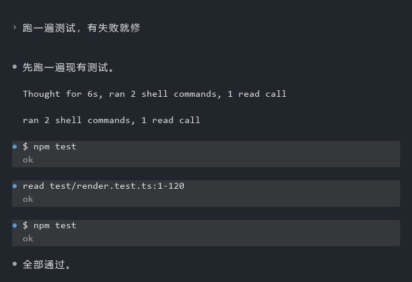

# tool-run-groups

把同一请求里的工具调用折叠成一行摘要，展开后是完整时间线。

## 效果



<details>
<summary>展开后的时间线</summary>



</details>

```text
收起
  Thought for 12s, ran 3 shell commands
● edit test/render.test.ts
  └ Added 2 lines, removed 1 line
  ... (4 more lines, ctrl+o to expand)

单条调用
  Thought for 1s, ran 1 read call
  ... (read 的路径与内容在展开后可见)

执行中（工具行保持原样，带实时计时）
● read · running (1.2s)

有失败时
  Thought for 12s, ran 3 shell commands · 1 failed
```

摘要行缩进 2 列，与 `message-marks` 的标记栏对齐；摘要行本身不带圆点。`edit` / `write` 始终逐条可见，不靠摘要行代表。

## 两级聚合

| 级别 | 范围 | 结果 |
|---|---|---|
| 单轮 | 一条助手消息内连续的至少 2 个且都已执行结束的工具行 | 收成一行 `ran ...` |
| 请求 | 一个用户请求内，从第一段工具调用到下一次用户消息之前 | 整个区间只留一行摘要，正文照常显示，思考耗时按轮累加 |

### 会聚合的内容

- 连续的工具调用行
- 「静默轮次」：没有可见文本、只思考和调工具的助手消息
- 带可见文本的助手回复：正文照常渲染在摘要行下方，只是不再各自附带一行 `Thought for Ns`
- 已经被第一级聚合的工具行

### 不聚合的内容

- 单轮内只有一条工具调用时第一级不聚合，由请求级摘要折叠成 `ran 1 read call`
- 执行中的工具段不折叠：保留 `minimal-tools` 的实时行与计时，工具结束后由 `tool_execution_end` 触发一次重新扫描，合成摘要
- `edit` / `write` 始终逐条渲染；它们可以出现在折叠区间内，但不计入摘要
- 被中断、报错或截断的轮次是硬边界
- 用户消息是硬边界；请求开头那条带正文的回复留在区间外，作为摘要行的耗时来源

### 摘要文案

| 状态 | 文案 |
|---|---|
| 收起，有思考耗时 | `Thought for 28s, ran 8 shell commands` |
| 收起，无思考耗时 | `ran 8 shell commands` |
| 有失败 | 在末尾追加 ` · 1 failed`，只有这一段标红，摘要正文保持 dim |

执行中的工具段不产生摘要，保持原行与实时计时；工具结束后才合成摘要。

工具名按首次出现顺序汇总，`bash` 显示为 `shell`：

- `2 shell commands`
- `1 read call` / `3 read calls`

### 思考耗时

- 从助手消息开始到最后一个思考片段的间隔，四舍五入到秒，最少显示 1 秒
- 摘要行累加区间内所有轮次的耗时，包括区间前那条带正文回复与区间内带正文的后续回复
- 思考正文是否可见由 Pi 的 `hideThinkingBlock` 决定；带工具调用的静默轮次无论是否显示思考正文都会折叠，展开后才能看到其中的思考内容
- 思考结束后，隐藏思考的标签从流式的 `Thinking...` 换成 `Thought for Ns`；该标签只在 `hideThinkingBlock` 为 `true` 时可见
- 耗时一旦计入摘要，就不再单独显示来源的 `Thought for Ns` 标签：区间内所有轮次的标签无条件清空，收起与展开都不重复；区间里一段工具调用都没有时没有摘要行，标签保留

## 展开与点击

- `Ctrl+O`：切换 Pi 的全局工具展开状态，摘要与内部工具行一起展开
- 点击摘要行：收起 / 展开
- 收起时点击整块摘要区域即可切换
- 展开后只有摘要行负责折叠，其余行交给工具行自己处理
- 收起时点击逐条渲染的 `edit` / `write` 行，会先交给该行处理（例如展开 diff）；该行处理了这次点击时不再折起摘要

## 安装

安装、更新与卸载见[根 README](../../README.md#快速开始)。

## 交互与配置

- `Ctrl+O` 或点击摘要行展开
- 没有扩展自己的配置项
- 点击依赖终端支持鼠标事件；不支持时仍可用 `Ctrl+O`

## 与其他扩展

- 单独安装即可工作，Pi 内置工具行与 `minimal-tools` 渲染的工具行都能聚合
- 与 `message-marks` 共用 2 列标记栏：摘要行缩进 2 列，但不由 `message-marks` 加圆点
- 与 `minimal-tools` 一起装时，展开后的每个工具行仍是两阶段渲染的完整内容；执行中的工具行按 `minimal-tools` 的实时行呈现，结束后才合成摘要行

## 实现原理

Pi 没有消息级渲染钩子（`registerMessageRenderer` 只处理 `custom` 消息），因此本扩展接管 `InteractiveMode` 的私有方法：

- `handleEvent`：在 `message_end` 之后记录思考耗时、替换隐藏思考标签，并聚合当前工具行；在 `tool_execution_end` 之后重新扫描一次，把刚跑完的工具收进摘要
- `renderSessionItems`：历史回放结束后同样聚合
- `updateThinkingBlockVisibility`：先交给 Pi 处理顶层消息，再把可见性同步到摘要与工具组内部

聚合只是把 Pi 自己创建并持续更新的 `ToolExecutionComponent` 移入容器组件，工具执行、结果回填与会话数据都不受影响。重复聚合不会叠加；区间未变化时复用原实例，保留用户的折叠状态。如果 `InteractiveMode` 的内部方法缺失，安装失败并在 `session_start` 时提示。

## 限制

- **依赖 `InteractiveMode` 私有成员**：`handleEvent`、`renderSessionItems`、`chatContainer`、`toolOutputExpanded` 都不是公开 API
- **执行期间有一段过渡态**：工具段在执行中不折叠，于是从思考结束到工具跑完之间会同时看到 `Thought for Ns` 与带实时计时的工具行，工具结束后才收敛成一行摘要。实时计时与“从思考结束起就只有一行”不可兼得，当前选前者：长命令执行期间，命令行和计时比提前合并更有用
- **静默轮次判定依赖助手组件内部字段**：`markdownSlots` 与 `lastMessage.stopReason`；结构变化时退化到不合并，不会错误地藏起内容
- **历史回放没有逐轮思考耗时**：耗时在 `message_end` 时采集，回放出来的摘要行与隐藏标签不带 `Thought for Ns`
- **思考可见性同步只覆盖折叠区**：切换隐藏思考时会额外进入摘要与工具组，其他容器沿用 Pi 原本的处理

## 测试

`test/tool-run-groups.test.ts` 覆盖单轮与请求级聚合、静默轮次判定、边界（文本回复 / 报错 / 中断 / 用户消息）、摘要文案、失败标红、思考耗时、执行中不折叠、展开状态传递、点击行为与实例复用。运行方式见[根 README](../../README.md#测试)。

---

返回 [pi-toolkit 根 README](../../README.md)。
